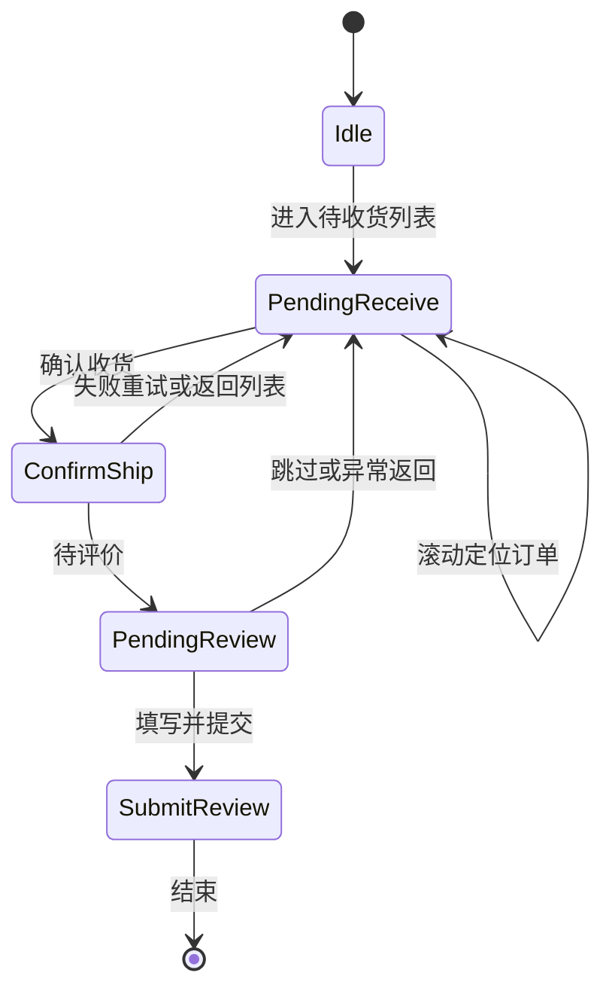

# 24SC 逐步实现核对指南（与源 `24SC.xpp` 高度一致）

业务脚本为 XXTouch 编译字节码（`.xxt`），**权威行为以本地完整 [`soucre/24SC/24SC.xpp`](../soucre/24SC/24SC.xpp) 为准**。本文件提供与 [`jd-xxtouch-24SC-development-plan.md`](jd-xxtouch-24SC-development-plan.md) 逐项对应的**仓库侧核对表**：在 IDE 中修改或对照时，逐项打勾并填入 IDE 校准列，避免偏离源项目模块边界。

**手册索引**：[XXTouch 开发手册目录](https://xxtouch.app/docs/handbook/)（XPP、XUI、ui_element、screen、image、touch、app、thread、proc 等）。

---

## 0. 环境基线（对应文档 §3 第 1 步、SC-1 前置）

| 项 | 记录值（在 IDE/设备上填写） |
|----|------------------------------|
| 京东 App 版本 | |
| 设备型号与 iOS 版本 | |
| 逻辑分辨率/缩放 | |
| XXTouch 版本 | |
| 相册/网络/辅助权限 | 已开 / 未开 |
| 测试账号性质 | 自有小号 / 授权号（禁止未授权） |
| 参考包 | `soucre/24SC/24SC.xpp`，`Info.lua` 中 `BundleVersion`（当前仓库记录为 1.0.713） |

---

## 1. 调用链 IDE 校准（待填：全局函数名 / 标签）

将下列树中 `→` 后条目在 IDE 中展开为**实际全局函数名或跳转标签**，填入「IDE 实际符号」列；与源包行为冲突时以源包为准。

| 层级 | 假定模块（文件名） | IDE 实际符号（自填） | 与源包一致（Y/N） |
|------|-------------------|---------------------|-------------------|
| L0 | `main.xxt` | | |
| L1 | `脚本配置界面.xxt` | | |
| L1 | `界面处理主函数.xxt` | | |
| L2 | `确认收货或评价主函数.xxt` | | |
| L3 | `收菜相关函数.xxt` | | |
| L3 | `收菜_确认收货.xxt` | | |
| L3 | `收菜_确认收货返回.xxt` | | |
| L3 | `收菜_评价.xxt` | | |
| L3 | `收菜_评价返回.xxt` | | |
| L3 | `评价函数.xxt` | | |
| L3 | `确认收货函数.xxt` | | |
| L* | `算法滑动.xxt` / `滑块轨迹.xxt` / `旋转轨迹.xxt` | | |
| L* | `下单_公共界面.xxt`、`下单_JD复登.xxt`、`下单_设置地址.xxt`、`设置地址主程序.xxt`、`设置地址相关函数.xxt`、`代付相关函数.xxt`（按需） | | |

---

## 2. SC-1：`main.xxt`

| 核对项 | 说明 |
|--------|------|
| 启动顺序 | 是否先初始化日志/进程字典、是否加载 XUI 默认值 |
| 配置读取 | 是否在进入业务前读完界面绑定变量 |
| 任务形态 | 单次 / 循环；循环间隔是否与配置一致 |
| 退出与异常码 | 正常结束、用户中止、异常分支是否有区分记录 |

**验收**：冷启动一次，日志时间顺序完整可追溯。

---

## 3. SC-2：`界面处理主函数.xxt`

为每个分支填写一行（可复制增行）：

| 分支说明（语义） | 触发条件（界面/截图关键字） | 处理动作 | 与源包一致 |
|------------------|----------------------------|----------|------------|
| 返回首页 | | | |
| 关闭弹窗 | | | |
| 网络失败重试 | | | |
| （继续添加） | | | |

**验收**：表格或导出注释与运行时分支覆盖一致。

---

## 4. SC-3：`脚本配置界面.xxt` + `interface.xuic`（及 `xui-sub.xuic`）

| 绑定变量语义（示例） | XUI 控件/键名（自填） | 默认值 | 运行时读取处（模块/函数） |
|---------------------|----------------------|--------|---------------------------|
| 账号 | | | |
| 间隔 | | | |
| 开关项（逐项） | | | |

**验收**：每列均可追溯到 `确认收货或评价主函数.xxt`（或等价总控）中的实际使用。

---

## 5. SC-4：`确认收货或评价主函数.xxt`（状态机）

### 5.1 主路径状态（与文档一致）

### 5.2 失败分支（与源包对齐占位）

| 自状态 | 条件或界面 | 下一动作 | 源包是否如此 |
|--------|------------|----------|--------------|
| ConfirmShip | （自填） | | |
| PendingReview | （自填） | | |
| SubmitReview | （自填） | | |

**验收**：流程图 + 上表齐套；最小闭环跑通一单。

---

## 6. SC-5～SC-10：收菜与评价模块

| ID | 模块文件 | 行为要点（与源一致核对） | `res/` 依赖提示 | 验收 |
|----|----------|--------------------------|-----------------|------|
| SC-5 | `收菜相关函数.xxt` | 列表进入、滚动策略、停滚条件、定位订单项 | 若有列表标记图 | 截图/日志 |
| SC-6 | `收菜_确认收货.xxt` / `收菜_确认收货返回.xxt` | 按钮命中区域、返回栈 | 确认收货相关 PNG | 单次闭环 |
| SC-7 | `收菜_评价.xxt` / `收菜_评价返回.xxt` | 匿名、话题、晒图分支 | 评价入口相关 | 单次闭环 |
| SC-8 | `评价函数.xxt` | 星级、文案、话题、晒图/跳过、提交 | 「写评价」「提交」「评价中心」等 | 与模板阈值一致 |
| SC-9 | `收菜_删除订单.xxt` / `收菜_永久删除.xxt` | 触发条件、二次确认 | 按需 | 仅需求启用时测 |
| SC-10 | `确认收货函数.xxt` | 与 SC-6 封装关系、避免重复点击 | 与 SC-6 协调 | 不重复误触 |

京东界面改版时：**同步更新 `res/` 内 PNG 与匹配阈值**，并与 [`jd-xxtouch-24SC-development-plan.md`](jd-xxtouch-24SC-development-plan.md) 所述命名对照。

---

## 7. SC-11～SC-12：验证码与恢复

| ID | 模块 | 记录项 |
|----|------|--------|
| SC-11 | `算法滑动.xxt`、`滑块轨迹.xxt`、`旋转轨迹.xxt` | 触发界面特征、超时秒数、最大重试、录屏归档路径 |
| SC-12 | `处理上次出现的界面.xxt` | 持久化的界面标识、杀进程后恢复步骤、是否与源栈一致 |

---

## 8. SC-13～SC-15：按需共用、复登、日志

| ID | 模块 | 说明 |
|----|------|------|
| SC-13 | `下单_*`、`设置地址主程序.xxt`、`设置地址相关函数.xxt`、`代付相关函数.xxt` | **仅实现 SC 实际经过的分支**；与 24XD 同名文件改动见下节 |
| SC-14 | `pjy.xxt`、`复登相关函数.xxt`、`下单_JD复登.xxt` | 踢下线 / 登录失效复登场景台账 |
| SC-15 | `nLog.xxt`、`text_replacement.xxt` | 日志路径、敏感字段脱敏规则与源一致 |

### 修改共享层前（摘自 [`shared-modules-manifest.md`](shared-modules-manifest.md)）

与 `soucre/24XD/24XD.xpp` **顶层同名**文件改动前：对比双包、选定主副本、替换后 **SC 与 XD 双端冒烟**。

---

## 9. 验证与回归清单（文档 §3）

- [ ] **环境**：京东版本、分辨率、XXTouch、权限已固定并记录在 §0。
- [ ] **配置**：测试小号；最小参数集完成一单「确认收货 + 评价」。
- [ ] **异常**：断网、`评价中心_网络请求失败`、活动弹窗（对照 `res/` 命名）。
- [ ] **合规**：仅限自有订单与授权用途。
- [ ] **回归**：京东小版本升级后重跑 **SC-4～SC-8** 核心路径（记录在下行）。

| 回归日期 | App 版本 | SC-4 | SC-5 | SC-6 | SC-7 | SC-8 | 备注 |
|----------|----------|------|------|------|------|------|------|
| | | | | | | | |

---

## 10. 与 [`jd-xxtouch-24SC-development-plan.md`](jd-xxtouch-24SC-development-plan.md) 任务表映射

| 文档序号 | 本指南章节 |
|----------|------------|
| SC-1～SC-3 | §0～§4 |
| SC-4 | §5 |
| SC-5～SC-10 | §6 |
| SC-11～SC-12 | §7 |
| SC-13～SC-15 | §8 |
| §3 验证 | §9 |
