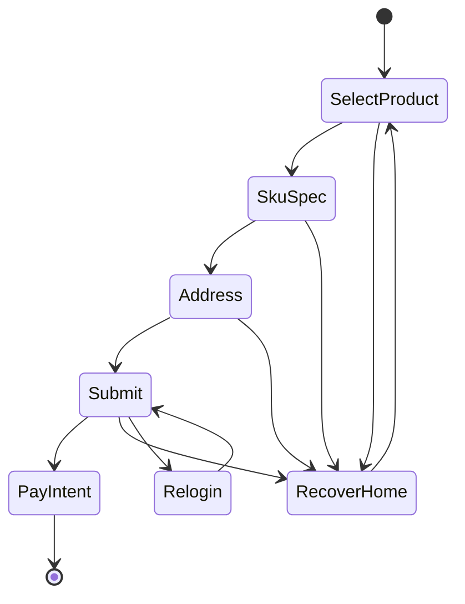

# 24XD 实施指南（与源 `.xpp` 及 XXTouch 手册对齐）

本文档与 [`jd-xxtouch-24XD-development-plan.md`](jd-xxtouch-24XD-development-plan.md) 中 XD-1～XD-16、「§3 合规」「§4 验证」一一对应，作为在 **XXTouch IDE** 内对照 [`soucre/24XD/24XD.xpp`](../soucre/24XD/24XD.xpp) 实现与验收的操作清单。业务脚本为 `.xxt` 字节码时，所有「函数名」须在 IDE 中校准为实际符号。

**手册索引**：[XXTouch 开发手册目录](https://xxtouch.app/docs/handbook/)（重点：[xpp](https://xxtouch.app/docs/handbook/xpp/)、[xui](https://xxtouch.app/docs/handbook/xui/)、[screen](https://xxtouch.app/docs/handbook/screen/)、[image](https://xxtouch.app/docs/handbook/image/)、[touch](https://xxtouch.app/docs/handbook/touch/)、[ui_element](https://xxtouch.app/docs/handbook/ui_element/)、[app](https://xxtouch.app/docs/handbook/app/)、[file](https://xxtouch.app/docs/handbook/file/)、[thread](https://xxtouch.app/docs/handbook/thread/)）。

**双包纪律**：修改 [`shared-modules-manifest.md`](shared-modules-manifest.md) 所列任一顶层同名文件后，须在 **24SC.xpp** 与 **24XD.xpp** 各执行一次冒烟。

---

## A. 环境与入口绑定（XD-1）

### A.1 包元数据（仓库已检出部分）

[`soucre/24XD/24XD.xpp/Info.lua`](../soucre/24XD/24XD.xpp/Info.lua) 当前含义：

| 键 | 值 |
|----|-----|
| `Executable` | `main.xxt` |
| `MainInterfaceFile` | `interface.xuic` |
| `BundleDisplayName` / `BundleIdentifier` | `24XD` |
| `BundleVersion` | `1.0.861` |

完整脚本树须在本地 IDE 工程中打开；Git 内未必包含全部 `.xxt` / `res/`。

### A.2 IDE 校准清单（验收：一次完整运行日志）

- [ ] 用 XXTouch 打开完整 **`24XD.xpp`**，确认顶层文件与 [`shared-modules-manifest.md`](shared-modules-manifest.md)「仅 24XD」「同名共享」一致。
- [ ] 对照 [xui](https://xxtouch.app/docs/handbook/xui/)，理清 **`interface.xuic`**、**`xui-sub.xuic`** 与脚本中读写配置的变量名、默认值、持久化路径。
- [ ] 跟踪 **`main.xxt`**：冷启动顺序（是否先读配置、主循环结构、异常退出）、与界面按钮/开关的绑定关系。
- [ ] 导出或截取一次 **冷启动→读完配置→进入主逻辑** 的完整日志（路径见 [`nLog.xxt`](shared-modules-manifest.md) 相关约定与团队规范）。

---

## B. 下单总状态机（XD-2）

### B.1 目标模块

**`下单主函数.xxt`**：总控状态机，须与源项目分支顺序一致。

### B.2 状态转移（待 IDE 填入真实标签/函数边界）

- **RecoverHome**：对应 **`下单_返回到首页.xxt`**（XD-9）调用时机须在源码中标注。
- **Relogin**：对应 **`下单_JD复登.xxt`** / **`复登相关函数.xxt`**（XD-12）。

### B.3 验收

- [ ] 流程图与 IDE 内 **`下单主函数.xxt`** 的分支一致（含异常出口）。
- [ ] 列出所有「可跳转返首页」「可触发复登」的条件表达式或调用点（表格或注释）。

---

## C. App 内主路径（XD-3）

### C.1 目标模块

**`下单_APP下单.xxt`**：App 内商详 → SKU → 立即购买（或等价）路径。

### C.2 打断点阶梯（建议顺序）

1. 进入商品详情稳定性（前后台、加载完毕判定）。
2. 规格/SKU 选择与库存/限购提示分支。
3. 「立即购买」或等价入口与后续收银台前界面栈。
4. 与 **`下单相关函数.xxt`** / **`下单相关截图函数.xxt`** 的衔接点。

### C.3 验收（最小下单闭环）

- [ ] 使用 **低价测试商品**，与业务约定止步点（例如仅到「提交订单」），完成一次最小闭环。
- [ ] 记录京东 App **版本号**、设备分辨率、XXTouch 版本（回归基线）。

---

## D. 通用封装与截图模板（XD-4、XD-5）

### D.1 `下单相关函数.xxt` — 封装清单（自建表）

| 封装函数（IDE 实际名） | 职责摘要 | 被调用方文件 |
|------------------------|----------|----------------|
| （待填） | （待填） | （待填） |

### D.2 `下单相关截图函数.xxt` 与 `res/` — 改版对照表

| `res/` 相对路径（PNG） | 截图/找图函数 | 匹配阈值/区域备注 | 上次京东改版验证日期 |
|------------------------|---------------|-------------------|----------------------|
| （待填） | （待填） | （待填） | （待填） |

### D.3 验收

- [ ] XD-4：封装列表覆盖 IDE「查找引用」中出现的全部对外入口。
- [ ] XD-5：每张关键模板均有对应函数与失效时的降级策略说明。

---

## E. 与 SC 同源的界面与地址（XD-6、XD-7、XD-16）

以下文件在清单中为 **顶层同名**（见 [`shared-modules-manifest.md`](shared-modules-manifest.md)），须在 **`24SC.xpp`** 与 **`24XD.xpp`** 间做 **diff**（IDE 或导出源码），争议行为须有场景说明。

| 模块 | XD 任务摘要 |
|------|----------------|
| `下单_公共界面.xxt` | 与 SC 行为对齐；双包冒烟。 |
| `界面处理主函数.xxt` | 弹窗、返回、网络失败分支与 XD 主链路衔接一致。 |
| `下单_设置地址.xxt`、`设置地址相关函数.xxt` | 默认地址、切换地址、风控提示。 |
| `处理上次出现的界面.xxt`（XD-16） | 下单场景杀进程/切 App 后恢复路径；与 SC 同源逻辑一致。 |

### E.1 地址用例（验收）

- [ ] 默认地址无需切换即可完成下单路径。
- [ ] 强制切换地址（新增/编辑/列表选择）后仍可提交。
- [ ] 风控或配送提示出现时，日志与截图分支符合 `res/` 与截图函数约定。

---

## F. 优惠券与返回首页（XD-8、XD-9）

| 模块 | 核对项 |
|------|--------|
| `下单_领优惠券.xxt` | 领券失败是否 **阻塞** 下单；超时重试次数；与主状态机衔接。 |
| `下单_返回到首页.xxt` | 调用栈：何种异常、何种界面栈深度下触发；是否与 **`下单主函数.xxt`** 状态复位一致。 |

### 验收

- [ ] 分支用例：领券成功 / 失败 / 跳过。
- [ ] 异常注入：断网、弹窗遮挡；确认返首页不会死循环。

---

## G. 支付相关合规闸门（XD-10、XD-11）

**须在书面确认自动化边界前，不扩展脚本到最后一步支付或人脸环节。**

| 模块 | 闸门内容 |
|------|----------|
| `下单_扫码付款.xxt` | 是否仅 **调起扫码界面** 由人工完成；脚本止步点。 |
| `代付相关函数.xxt` | 代付链接/分享路径是否仅复制或唤起，是否禁止全自动确认。 |

### 验收

- [ ] 合规确认记录（责任人、日期、允许的最大自动化范围）。
- [ ] 脚本与配置中 **无** 支付密码、完整 Cookie、支付验证码硬编码（参见 [`jd-xxtouch-24XD-development-plan.md`](jd-xxtouch-24XD-development-plan.md) §3）。

---

## H. 登录与触控轨迹（XD-12、XD-13）

| 模块 | 核对项 |
|------|--------|
| `下单_JD复登.xxt`、`复登相关函数.xxt` | 会话失效检测、与 **`滑块轨迹.xxt`** / **`旋转轨迹.xxt`** 触发条件；超时与重试。 |
| `TouchIOS.xxt`（仅 XD 顶层） | 与 **`touch`** 封装及轨迹模块的分工；误触与坐标系约定（对照手册 [touch](https://xxtouch.app/docs/handbook/touch/)）。 |

### 验收

- [ ] 踢下线或 Cookie 失效场景可稳定进入复登并完成返回下单。
- [ ] 轨迹与 TouchIOS 联合回归：滑块场景无多余滑动。

---

## I. 下载与备用分支（XD-14、XD-15）

| 模块 | 核对项 |
|------|--------|
| `下载图片函数.xxt` | 调用时机、缓存目录、[file](https://xxtouch.app/docs/handbook/file/) 权限与磁盘余量。 |
| `备用代码.xxt` | IDE **全局查找引用**；若无任何引用则标记为候选删除或与团队确认保留理由。 |

### 验收

- [ ] 下载失败重试与路径可日志追溯。
- [ ] `备用代码.xxt` 引用报告存档。

---

## J. 整体验证顺序（文档 §4 + 回归）

按 [`jd-xxtouch-24XD-development-plan.md`](jd-xxtouch-24XD-development-plan.md) §4：

1. [ ] **最小闭环**：低价测试商品，止步点与业务一致。
2. [ ] **异常全集**：缺货、限购、风控弹窗、网络超时（对照 XD-5 与 `res/`）。
3. [ ] **双包回归**：改动任一共享顶层文件后，SC + XD 冒烟。

商品 ID、金额建议 **配置化**（[`jd-xxtouch-24XD-development-plan.md`](jd-xxtouch-24XD-development-plan.md) §3）。

---

## K. 「与源项目高度一致」自检表

- [ ] **文件级**：`24XD.xpp` 顶层集合与清单一致；XD 独有文件仅出现在清单「仅 24XD」。
- [ ] **调用级**：`main.xxt` 可达性与 IDE 校准后的调用链一致。
- [ ] **行为级**：共享模块在 SC/XD 上对同一配置与界面状态的分支决策一致，或差异已文档化。
- [ ] **资源级**：`res/` 与截图函数对照表已维护并可增量改版。
